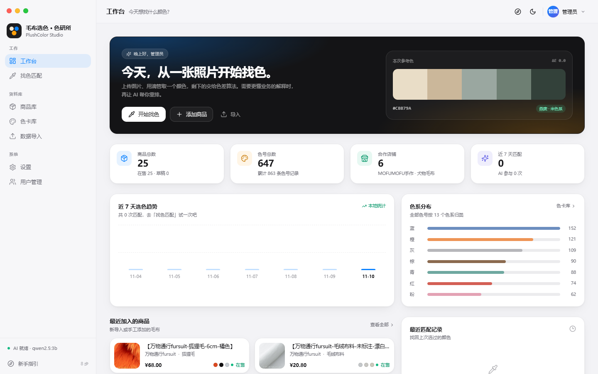
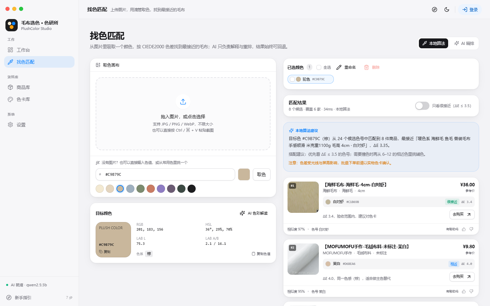

# 毛布选色 · 色研所

> PlushColor —— 面向毛布/绒布行业的「看图取色 → 匹配合格色号 → 一键找货」系统。
> macOS 风格界面 · 本地 CIEDE2000 匹配 + DeepSeek / Ollama 双 AI 通道 · 单容器部署。

  

---




## 它解决什么问题

挑毛布颜色时，口头说“奶油白”“雾霾蓝”往往对不上：不同屏幕、不同光线、不同缸号都会有偏差。本系统把颜色变成可计算的 Lab 值：

1. 上传一张参考图（宠物、家居、布料均可），用放大镜滴管取色；
2. 系统把颜色转成 CIEDE2000 色差，与商品库里的真实色号比对；
3. 输出「几乎一致 / 相近 / 灵感」三档结果，附商品图、店铺、价格与购买链接；
4. 可选让 AI 结合材质、场景给出排序理由与搭配建议（失败自动回退本地结果）。

## 功能

- **找色**：图片上传/拖拽/粘贴、5×5 均值取色放大镜、HEX/RGB/HSL/Lab、手动输入 HEX
- **大图上传**：商品图不限大小，16MB 分片、断点续传与进度提示；50GB 级会话只受磁盘空间限制，超大图不做同步缩略
- **商品库**：增删改查、多色号、搜索筛选、分页、全选当前页 / 全选筛选结果、批量上下架/归档/删除
- **色卡库**：按商店 / 按色号排序、按色系筛选，输入 HEX 时按 CIEDE2000 色差排序并显示 ΔE；同一店铺同色只保留一张，不同店铺分别展示
- **商家覆盖**：找色结果保证每个有在售商品的店铺至少出现一次，不会因为某家店整体色差略远而整店消失
- **导入**：JSON / CSV 粘贴或上传，dry-run 预览，逐行错误报告
- **AI**：DeepSeek（deepseek-chat / deepseek-flash-1017）与 Ollama 双通道；Ollama 地址填写后自动读取本机/局域网模型并优先选择 qwen2.5:3b，后台可配 Key/模型/提示词
- **免登录找色**：访客直接进入找色匹配；设置、商品/色号增删改查、导入与用户管理需管理员登录
- **颜色 Tab**：每次取色自动保存为颜色标签，标签保留各自结果，支持重命名、全选、批量删除；切换页面不丢失，刷新才清空
- **淘宝同步**：6 家店铺 25 个真实毛布商品、863 条色号；管理端一键导入 `data/import/taobao-sync.json`，按店铺+色名、再按店铺+色值去重展示
- **商品命名**：商品显示为【商家-毛布类型-毛布长度-色号】，列表与推荐都按匹配色号生成
- **设置**：AI、外观、账户、数据；用户与权限管理
- **新手指引**：intro.js 八步引导，随时重看
- **部署**：Docker Compose 一键启动（非 root），Windows `start.bat` 双击启动

## AI 配置

进入「设置 → AI 助手」：

- **Ollama**：填写服务地址（如 `http://127.0.0.1:11434` 或局域网地址），系统会请求 `/api/tags` 自动列出可用模型，并按 `qwen2.5:3b → qwen2.5 → qwen3.5 → qwen → llama → deepseek` 的顺序给出建议；无需手工输入模型名，点右侧刷新即可重新读取。
- **DeepSeek**：填 API Key、API 地址与模型名（支持 `deepseek-chat` 或 `deepseek-flash-1017`），保存后可测试连接。
- AI 只负责「重排 + 解释」，色差与分数始终由本地 CIEDE2000 计算；AI 超时、返回非法 JSON 或未配置时自动回退本地结果。

当前开发数据中配置的是远程 Ollama `http://120.26.236.28:11415` + `qwen2.5:3b`；正式部署请改成你自己的地址。

## 快速开始（Docker，推荐）

```bash
cp env.example .env        # 可选：修改 ADMIN_PASSWORD / APP_PORT
docker compose up -d --build
# 或 Ubuntu/macOS 一键：chmod +x start.sh && ./start.sh
# 打开 http://localhost:8000   （首次为 admin / admin123，请立即修改）
```

数据目录 `./data` 会自动创建；容器内以 `app`（uid 10001）运行，启动脚本会自动修正挂载目录权限，无需 `sudo`。普通用户只需在 `docker` 组内即可。

## 快速开始（Windows）

双击 `start.bat`。脚本会优先用 Docker；没有 Docker 时尝试本地 Python 模式，并监听 `0.0.0.0`。若 8000 被其他程序占用，会自动改用 8011–8020 中的空闲端口。

局域网访问：用 `ipconfig` 查本机 IPv4，打开 `http://<本机IP>:8011`。首次需在管理员 PowerShell 放行端口：

```powershell
netsh advfirewall firewall add rule name="PlushColor LAN 8000-8020" dir=in action=allow protocol=TCP localport=8000-8020 profile=any
```

上外网/跨网段请加 Nginx HTTPS，不要直接暴露端口；并先修改默认密码。

需要后台常驻（关闭终端也不停）可双击 `serve.bat`，日志写入 `data\server.log`，默认端口 8011。

## 本地开发

```bash
# 后端（在仓库根目录）
python -m venv .venv
.venv\Scripts\activate              # Linux/macOS: source .venv/bin/activate
pip install -r backend/requirements.txt
python -m uvicorn app.main:app --app-dir backend --reload --port 8000

# 前端（另开终端）
cd frontend
npm install
npm run dev        # http://localhost:5173，/api 与 /uploads 代理到 8000
```

前端生产构建：`cd frontend && npm run build`，FastAPI 会直接托管 `frontend/dist`。首次启动会自动创建 `data/` 与默认管理员；演示商品默认关闭（需要时设 `SEED_DEMO=true`），真实数据请通过导入页面写入。

## 目录

```
doc/            设计与规范（先读 doc/README.md）
backend/app/    FastAPI 应用
frontend/       Vite + React + Tailwind + shadcn 风格组件
tools/          淘宝登录态采集脚本（可选）
tests/          接口冒烟测试与说明
data/           运行期数据：SQLite、上传、密钥（已 gitignore）
```

## 数据说明（请先读）

淘宝店铺未登录时只会返回登录跳转页，**本项目不内置绕过登录的爬虫**。当前 `data/` 中的商品库来自你提供的六家目标店铺（当前完成 6 家），使用已登录的浏览器会话采集后导入：

- **海鲜毛布 / 八荒九野海鲜毛大排档**：4 款暖色、冷色、黑白灰与弹力毛布
- **犬物毛布 / 犬物语兽装 Fursuit**：6 款短毛、长毛、弹力毛、超短毛与咩咩毛
- **喵喵毛布 / 北极狼创物工坊**：2 款 3.5cm / 5cm 咩咩毛

总计 **25 个真实毛布商品、863 条色号记录（647 个不重复色值、580 个店铺色）**；6 家目标店铺已全部同步（海鲜毛布、犬物毛布、喵喵毛布、月亮制兽Moonfur、MOFUMOFU手作、万物通行fursuit）。淘宝风控会在连续打开商品后要求重新登录，采集脚本按批次断点续抓。色卡库先在店铺内按色名去重，再按「店铺 + 色值」兜底去重：同一店铺同色只保留一张，不同店铺同色分别展示并标注店铺名。商品图片取自对应 SKU 的绒面图并裁切中心区域；色值由图片中心 60% 区域取平均后转 sRGB HEX，仅作看色参考，批量下单前请以实物色卡为准。购买链接指向对应 `item.taobao.com` 商品页，价格与库存以淘宝实时页面为准。所有商品的颜色变体均已入库（单商品最多 71 色，不再截断）。

更新数据时：

1. 在「数据导入」页粘贴或上传 JSON / CSV，先 dry-run 预览再写入；
2. 或运行 `python tools/collect_taobao.py --login` 在你自己已登录的浏览器会话中采集，再导入生成的文件。

字段说明见 [商品数据采集与导入说明](doc/10-商品数据采集与导入说明.md)。演示模式（`SEED_DEMO=true`）仍保留 24 条本地占位商品，仅用于功能演示。

## 测试与验收

功能冻结后统一测试，结果见 [测试报告](doc/12-测试报告.md)：

- 接口冒烟 41/41；Ollama 模型发现单测 4/4
- 真实 Ollama（qwen2.5:3b）AI 推荐：`mode:"ai"`、8 候选、16–30s（模型已加载时约 16s）；颜色 Tab 场景实测 29.1s；AI 色彩解读约 7–12s
- DeepSeek / 超时 / 非法 JSON 回退通过 mock 覆盖
- Playwright 全流程：登录、找色取色、商品 CRUD/筛选/全选/批量、色卡、导入、设置、用户权限、intro.js、深色、移动端
- 明暗两套主题与 390px 移动端截图存于 `doc/screenshots/`

> Docker 镜像未在本开发机实测（该机器未安装 Docker）；`Dockerfile` 与 `docker-compose.yml` 已做静态审查。Windows 本机模式已实际启动到健康检查通过。

## 默认账号

`admin / admin123` —— 未配置 `ADMIN_PASSWORD` 时的默认值，**首次登录后请立即修改**（设置 → 账户）。生产部署请通过 `.env` 的 `ADMIN_PASSWORD` 指定强密码。

## 文档

- [文档索引](doc/README.md)
- [毛布颜色与选色指南](doc/01-毛布颜色与选色指南.md)
- [需求规格说明书](doc/02-需求规格说明书.md)
- [系统架构设计](doc/03-系统架构设计.md)
- [API 接口规范](doc/05-API接口规范.md)
- [部署与运维手册](doc/08-部署与运维手册.md)
- [测试报告](doc/12-测试报告.md)
- [开发任务树](doc/11-开发任务树.md)

## 免责声明

色差受光线、屏幕、材质影响，系统结果仅作选色参考，批量下单前请以实物色卡/缸样确认。商品图片与链接版权归原店铺所有。
