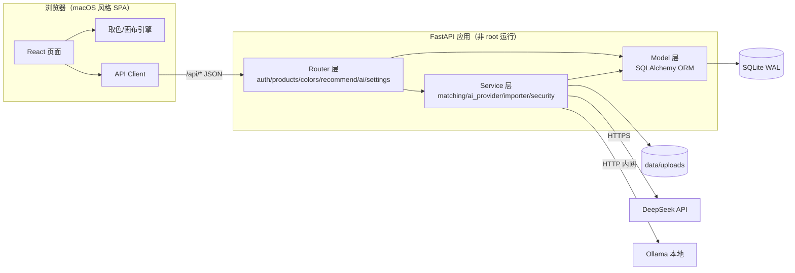
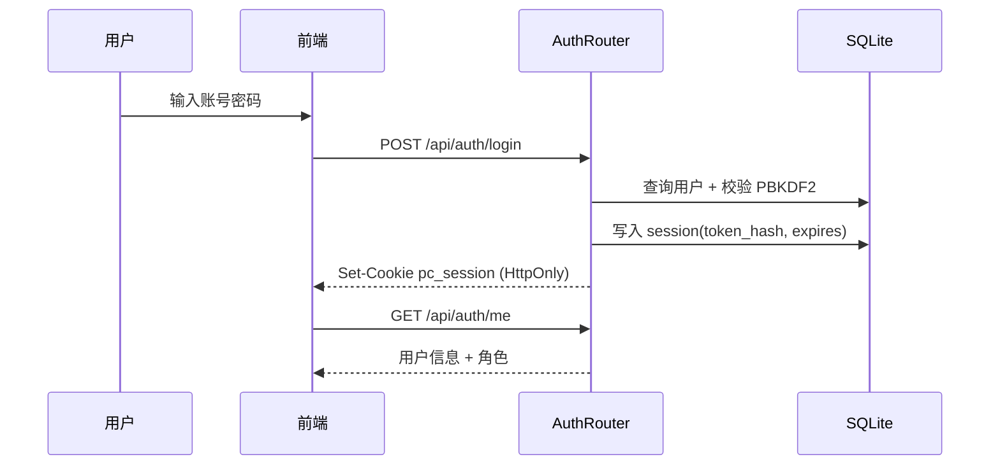
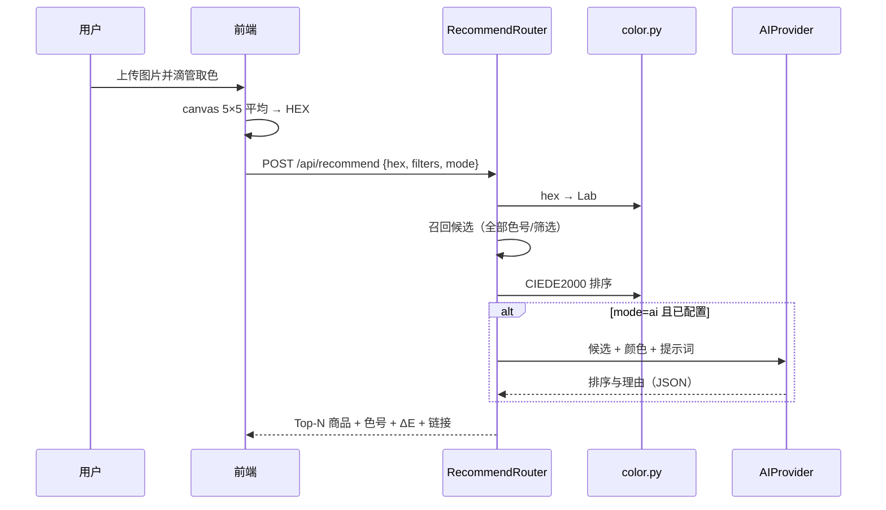

# 系统架构设计

> 版本：v1.0 ｜ 目标：高内聚、低耦合、单模块可替换、单机可运维

---

## 1. 总体架构



**核心思想：分层 + 端口适配。** 路由只做参数校验与编排；业务规则在 service；持久化细节在 model/repository；外部 AI 通过统一的 `AIProvider` 端口适配，换供应商不改业务代码。

---

## 2. 模块划分与职责

| 模块 | 目录 | 职责 | 对外契约 | 可替换性 |
|---|---|---|---|---|
| 认证 auth | `backend/app/routers/auth.py`、`services/security.py` | 登录、会话、密码哈希、限流 | `/api/auth/*` | 可换 OAuth/LDAP，仅改此模块 |
| 商品 products | `routers/products.py` | 商品 CRUD、批量、导入导出 | `/api/products/*` | 独立 |
| 色卡 colors | `routers/colors.py` | 色号 CRUD、色系归类 | `/api/colors/*` | 独立 |
| 颜色科学 color | `services/color.py` | HEX/RGB/HSL/Lab 转换、ΔE00、色系 | 纯函数 | 无状态，可单测 |
| 推荐 recommend | `routers/recommend.py`、`services/matching.py` | 候选召回、排序、打分、解释 | `/api/recommend/*` | 可换向量检索 |
| AI 适配 ai | `routers/ai.py`、`services/ai_provider.py` | DeepSeek/Ollama 调用、提示词渲染、降级 | `/api/ai/*` | 新增供应商只加适配器 |
| 设置 settings | `routers/settings.py`、`services/settings_store.py` | 键值配置、密钥加密、脱敏 | `/api/settings/*` | 独立 |
| 上传 uploads | `routers/uploads.py` | 图片校验、落盘、静态访问 | `/api/uploads` | 可换 S3 |
| 用户 users | `routers/users.py` | 用户管理（admin） | `/api/users/*` | 独立 |
| 统计 stats | `routers/stats.py` | 首页看板 | `/api/stats` | 独立 |
| 前端页面 | `frontend/src/pages` | 页面编排 | 仅调用 API Client | 页面可独立改 |
| 前端组件 | `frontend/src/components` | 展示与交互 | props | 样式可独立改 |
| 前端取色引擎 | `frontend/src/lib/color.ts`、`EyedropperCanvas.tsx` | 画布、取样、放大镜 | 组件事件 | 可换第三方 |

### 2.1 依赖规则（必须遵守）

1. `pages → components → ui` 单向依赖，禁止反向。
2. `router → service → model` 单向；router 不得直接写 SQL。
3. 跨模块只通过 service 公开函数或 HTTP API，不导入对方内部实现。
4. `services/color.py` 保持**纯函数、无 IO、无 DB**，任何模块可安全复用。
5. 前端不得出现业务常量（色系阈值、AI 默认提示词），统一由后端下发。

---

## 3. 关键流程

### 3.1 登录



### 3.2 找色推荐



### 3.3 AI 降级

```
请求 AI → 超时/网络错误/JSON 解析失败 → 记录 ai_error → 返回本地排序结果（mode 标记为 local_fallback）
```

任何 AI 故障都不能导致 5xx 或空白页。

---

## 4. 技术选型与理由

| 层 | 选型 | 理由 | 备选与代价 |
|---|---|---|---|
| 前端框架 | React 18 + TypeScript + Vite | 生态成熟、构建快、类型安全 | Next.js 过重，本系统无 SSR 需求 |
| 样式 | Tailwind CSS 3 + shadcn/ui | 原子化 + 可复制组件，完全可控，易做 macOS 风格 | Ant Design 视觉偏企业，定制成本高 |
| 路由 | react-router-dom 6 | 标准方案 | TanStack Router 学习成本高 |
| 请求 | 原生 fetch + 自定义 client | 少依赖、可控错误处理 | axios 增加体积 |
| 后端 | FastAPI + Pydantic v2 | 自动 OpenAPI、校验强、开发快 | Flask 缺少类型校验 |
| ORM | SQLAlchemy 2.0 | 成熟、可平滑迁移 PostgreSQL | 裸 sqlite3 难维护 |
| DB | SQLite（WAL） | 单机零运维、够用 | PostgreSQL 需额外容器 |
| AI | DeepSeek（云）/ Ollama（本地） | 一云一本地，覆盖在线与离线 | 仅云则离线不可用 |
| 引导 | intro.js | 轻量、稳定、可按步骤高亮 | 自研成本高 |
| 部署 | 单镜像多阶段 + Compose | 一键启动、体积小、非 root | 前后端双容器增加复杂度 |

---

## 5. 目录结构

```
autoselectcolor/
├─ doc/                         # 全部工程文档（本目录）
├─ backend/
│  ├─ app/
│  │  ├─ main.py                # 应用装配、静态托管、异常处理
│  │  ├─ config.py              # 环境变量与路径
│  │  ├─ database.py            # engine/session/初始化
│  │  ├─ models.py              # ORM 模型
│  │  ├─ schemas.py             # Pydantic 契约
│  │  ├─ deps.py                # 依赖注入（当前用户/管理员）
│  │  ├─ routers/               # 仅编排，不写业务
│  │  ├─ services/              # 业务规则与适配器
│  │  └─ seed.py                # 初始数据
│  ├─ tests/                    # pytest
│  ├─ requirements.txt
│  └─ Dockerfile
├─ frontend/
│  ├─ src/
│  │  ├─ pages/                 # 页面
│  │  ├─ components/            # 业务组件 + ui
│  │  ├─ lib/                   # api/color/utils/intro
│  │  └─ styles/
│  ├─ package.json
│  └─ vite.config.ts
├─ data/                        # 运行期数据（挂载卷）
├─ tools/                       # 导入与采集脚本
├─ docker-compose.yml
├─ Dockerfile                   # 多阶段构建
├─ start.bat / stop.bat
└─ README.md
```

---

## 6. 横切关注点

### 6.1 错误处理

- 统一异常结构：`{ "detail": "人类可读信息", "code": "MACHINE_CODE" }`。
- 业务异常 `AppError(status, code, message)`；未捕获异常返回 500 且不泄露堆栈。
- 前端 API Client 统一抛出 `ApiError`，页面用 Toast + 空状态呈现。

### 6.2 日志

- 结构化单行日志：时间、级别、请求 ID、方法、路径、状态、耗时。
- 不记录密码、Cookie、API Key、完整请求体。
- 容器 stdout，交给 Docker 收集。

### 6.3 配置优先级

`环境变量 > settings 表 > 代码默认值`。密钥只允许来自环境变量或加密后的 settings，前端永不接触明文。

### 6.4 性能策略

- 商品列表分页 + 索引（title/shop/material/status）。
- 颜色匹配一次性加载色号到内存（万级以内），O(n) 计算；结果缓存 60s（按 hex+筛选哈希）。
- 前端图片使用 `createImageBitmap` + 离屏 canvas，避免大图卡顿。
- 静态资源长缓存 + gzip（Uvicorn 前置可加 Nginx，可选）。

---

## 7. 安全设计

| 层 | 措施 |
|---|---|
| 传输 | 生产建议 HTTPS 反代；Cookie Secure 自动开启 |
| 认证 | 会话令牌 32 字节随机，存 SHA-256 哈希；7 天过期；登出即删 |
| 授权 | `require_user` / `require_admin` 依赖注入，默认拒绝 |
| 输入 | Pydantic 类型/长度/正则校验；HEX 正则 `^#[0-9a-fA-F]{6}$` |
| 上传 | 白名单 MIME + 魔数；分片落盘、不限应用层大小；随机文件名；禁止 `..` |
| 密钥 | Fernet 加密；日志与接口脱敏 |
| CSRF | SameSite=Lax + 写请求校验 `Origin` 同源 |
| 头 | CSP（self + 图片域名）、X-Frame-Options DENY、nosniff |
| 限流 | 登录 5 次/5 分钟/IP；AI 30 次/分钟/用户 |

---

## 8. 扩展点

1. **新增 AI 供应商**：实现 `AIProvider.chat()`，注册到工厂，前端下拉自动出现。
2. **新增匹配算法**：在 `matching.py` 注册策略（`ciede2000` / `lab_euclid` / `embedding`），API 参数 `algorithm` 切换。
3. **替换数据库**：仅改 `DATABASE_URL`，模型与查询保持 SQLAlchemy 兼容写法。
4. **新增导入源**：实现 `Importer.parse()` 返回统一 `ProductDraft`，路由复用。
5. **主题**：CSS 变量集中在 `styles/theme.css`，支持换肤不改组件。
