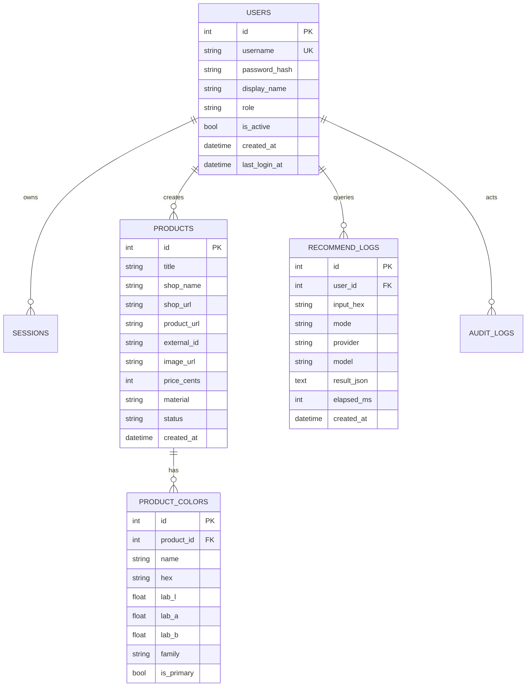

# 数据库设计

> 引擎：SQLite 3（WAL）｜ ORM：SQLAlchemy 2.0 ｜ 迁移：启动时 `create_all` + 轻量版本表
> 文件位置：`data/plushcolor.db`（容器内 `/app/data`）

---

## 1. ER 图



---

## 2. 表结构

### 2.1 users

| 字段 | 类型 | 约束 | 说明 |
|---|---|---|---|
| id | INTEGER | PK AUTOINCREMENT | |
| username | TEXT(50) | UNIQUE NOT NULL | 小写字母数字下划线，3–32 |
| password_hash | TEXT | NOT NULL | `pbkdf2_sha256$260000$salt$hash` |
| display_name | TEXT(50) | NOT NULL DEFAULT '' | |
| role | TEXT(10) | NOT NULL DEFAULT 'user' | `admin` / `user` |
| is_active | BOOLEAN | NOT NULL DEFAULT 1 | |
| created_at | DATETIME | NOT NULL | UTC |
| last_login_at | DATETIME | NULL | UTC |

索引：`ix_users_username`（唯一）。
约束：至少保留一个启用状态的 admin（业务层保证，禁止删除/降级最后一个 admin）。

### 2.2 sessions

| 字段 | 类型 | 约束 | 说明 |
|---|---|---|---|
| id | INTEGER | PK | |
| token_hash | TEXT(64) | UNIQUE NOT NULL | SHA-256(token) |
| user_id | INTEGER | FK users.id ON DELETE CASCADE | |
| created_at | DATETIME | NOT NULL | |
| expires_at | DATETIME | NOT NULL | 默认 +7 天 |
| user_agent | TEXT(255) | NULL | 审计用，截断 |

索引：`ix_sessions_token_hash`、`ix_sessions_user_id`、`ix_sessions_expires_at`。

### 2.3 products

| 字段 | 类型 | 约束 | 说明 |
|---|---|---|---|
| id | INTEGER | PK | |
| title | TEXT(200) | NOT NULL | 商品标题 |
| shop_name | TEXT(100) | NOT NULL DEFAULT '' | 店铺名 |
| shop_url | TEXT(500) | NULL | 店铺链接 |
| product_url | TEXT(1000) | NULL | 购买链接 |
| external_id | TEXT(64) | NULL | 淘宝商品 ID（去重键） |
| image_url | TEXT(1000) | NULL | 远程图或 `/uploads/xxx.jpg` |
| price_cents | INTEGER | NULL | 分，避免浮点误差 |
| currency | TEXT(3) | NOT NULL DEFAULT 'CNY' | |
| material | TEXT(50) | NOT NULL DEFAULT '' | 法兰绒/珊瑚绒/… |
| width_cm | INTEGER | NULL | 幅宽 |
| weight_gsm | INTEGER | NULL | 克重 |
| description | TEXT(2000) | NOT NULL DEFAULT '' | |
| tags | TEXT | NOT NULL DEFAULT '[]' | JSON 数组字符串 |
| status | TEXT(10) | NOT NULL DEFAULT 'active' | `active` / `archived` |
| created_by | INTEGER | FK users.id SET NULL | |
| created_at / updated_at | DATETIME | NOT NULL | |

索引：`ix_products_status`、`ix_products_shop`、`ix_products_material`、`ix_products_external_id`（唯一，允许 NULL）。
去重规则：`external_id` 存在时唯一；无 external_id 时按 `title + shop_name` 业务查重（导入时提示）。

### 2.4 product_colors

| 字段 | 类型 | 约束 | 说明 |
|---|---|---|---|
| id | INTEGER | PK | |
| product_id | INTEGER | FK products.id ON DELETE CASCADE NOT NULL | |
| name | TEXT(80) | NOT NULL | 色号名，如“燕麦白” |
| hex | TEXT(7) | NOT NULL | 统一大写 `#RRGGBB` |
| lab_l / lab_a / lab_b | REAL | NOT NULL | 写入时由服务端计算，保证一致 |
| family | TEXT(10) | NOT NULL | 自动归类 |
| is_primary | BOOLEAN | NOT NULL DEFAULT 0 | 每商品最多 1 个主色（业务保证） |
| note | TEXT(200) | NOT NULL DEFAULT '' | |
| created_at | DATETIME | NOT NULL | |

索引：`ix_colors_product_id`、`ix_colors_family`、`ix_colors_hex`。

### 2.5 settings

| 字段 | 类型 | 约束 | 说明 |
|---|---|---|---|
| key | TEXT(80) | PK | 如 `ai.provider` |
| value | TEXT | NOT NULL DEFAULT '' | 明文或密文 |
| is_secret | BOOLEAN | NOT NULL DEFAULT 0 | 为真时 value 为 Fernet 密文 |
| updated_at | DATETIME | NOT NULL | |
| updated_by | INTEGER | FK users.id SET NULL | |

默认键：

| key | 默认值 | 说明 |
|---|---|---|
| `ai.provider` | `deepseek` | deepseek / ollama / openai |
| `ai.deepseek.base_url` | `https://api.deepseek.com` | |
| `ai.deepseek.api_key` | 空（secret） | |
| `ai.deepseek.model` | `deepseek-chat` | 可改为 `deepseek-flash-1017` |
| `ai.ollama.base_url` | `http://localhost:11434` | 容器内用 `host.docker.internal` |
| `ai.ollama.model` | `qwen2.5:3b` | |
| `ai.temperature` | `0.3` | |
| `ai.timeout_seconds` | `30` | |
| `ai.prompt.deepseek` | 见文档 07 | skill 提示词 |
| `ai.prompt.ollama` | 见文档 07 | skill 提示词 |
| `ui.theme` | `system` | |
| `site.title` | `毛布选色 · 色研所` | |

### 2.6 recommendation_logs

| 字段 | 类型 | 约束 | 说明 |
|---|---|---|---|
| id | INTEGER | PK | |
| user_id | INTEGER | FK users.id CASCADE | |
| input_hex | TEXT(7) | NOT NULL | |
| input_lab_l/a/b | REAL | NOT NULL | |
| mode | TEXT(20) | NOT NULL | `local` / `ai` / `local_fallback` |
| provider | TEXT(20) | NULL | |
| model | TEXT(80) | NULL | |
| filters_json | TEXT | NOT NULL DEFAULT '{}' | |
| result_json | TEXT | NOT NULL | Top-N 精简结果 |
| elapsed_ms | INTEGER | NOT NULL DEFAULT 0 | |
| created_at | DATETIME | NOT NULL | |

索引：`ix_reclog_user_time(user_id, created_at)`。

### 2.7 audit_logs（可选，P2）

| 字段 | 类型 | 说明 |
|---|---|---|
| id | INTEGER PK | |
| user_id | INTEGER | |
| action | TEXT(50) | `product.create` 等 |
| target | TEXT(100) | 资源标识 |
| detail | TEXT(1000) | 摘要，不含敏感信息 |
| created_at | DATETIME | |

---

## 3. 数据完整性规则

1. `product_colors` 随商品级联删除；删除商品必须同一事务。
2. `hex` 统一大写；写入前由服务端规范化，并重算 Lab/family，**不信任前端传值**。
3. 每个商品至多一个 `is_primary=1`；设置新主色时清除旧主色。
4. `price_cents` 仅接受非负整数；前端以元展示，提交时 ×100 取整。
5. `status` 仅允许枚举值；非法值由 Pydantic 拒绝。
6. 删除最后一个 admin 或自我禁用 → 409。
7. 迁移策略：启动时 `create_all`；结构变更通过 `schema_version` 表 + 幂等 `ALTER TABLE` 脚本，禁止 drop 生产表。

---

## 4. 备份与恢复

```bash
# 备份（容器内或本地 data 目录）
sqlite3 data/plushcolor.db ".backup 'data/backup-$(date +%F).db'"
tar czf data/uploads-$(date +%F).tar.gz data/uploads

# 恢复
docker compose stop app
cp data/backup-2026-01-01.db data/plushcolor.db
docker compose start app
```

建议每日定时备份，保留 7 天；备份文件不含明文 API Key（已加密，但密钥随环境变量保管）。

---

## 5. 容量估算

- 商品 5,000 条 × 1KB ≈ 5MB；色号 20,000 条 × 0.3KB ≈ 6MB；日志 100,000 条 ≈ 50MB。
- SQLite 单文件在 1GB 内性能稳定；超过后建议归档日志或迁移 PostgreSQL。
